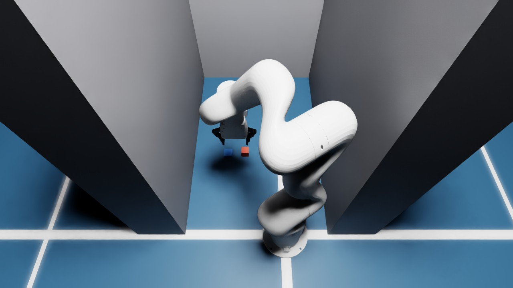

# sfhack13-isaac-twin

An NVIDIA Isaac Sim digital twin of the SF hackathon cell `sfhack13`. A UFactory 850 arm
with a UFactory xArm Gripper uses a wrist depth camera to find objects, picks them up, and
sets them down. Everything runs through the normal Viam APIs, so code written against the
twin also runs against the real cell.



## What's in here

| Path | What it is |
|---|---|
| `module/` | The Isaac Sim Viam module, published as [`hackathons:isaac-sim`](https://app.viam.com/module/hackathons/isaac-sim). A fork of [erh/viam-isaac-sim](https://github.com/erh/viam-isaac-sim). |
| `twin/machine-config.json` | A full machine config for the twin. Paste it into a machine's JSON config. |
| `twin/pick_cli.py` | The camera-guided pick cycle. It uses `viam machines part run`, so it needs only a `viam login`. |
| `twin/pick_demo.py` | The same cycle written with the Viam Python SDK, connecting with an API key. |
| `twin/results-*.jsonl` | Raw results from the trial runs described below. |

## Requirements

- An Ubuntu 22.04/24.04 x86_64 machine running `viam-server`, with an RTX-class NVIDIA GPU.
  This was tested on an L4 (22 GB) with Isaac Sim 5.0. See `module/README.md` for the driver
  notes; the 580 driver branch is the one validated.
- The machine must reach NVIDIA's asset server. The arm and gripper are Isaac's own
  `Ufactory/uf850` and `Ufactory/xarm_gripper` assets.

The module's `first_run.sh` installs Isaac Sim (10 GB+) the first time it runs. If the
machine already has Isaac Sim, add its Python to the module entry's environment to skip
the download:

```json
"env": {"ISAAC_PYTHON": "/path/to/isaac-sim/venv/bin/python"}
```

## Run it

1. Create a machine in the Viam app and paste in `twin/machine-config.json`.
2. Wait for `sim-world` to log `isaac sim world ready`. On a warm machine this takes about
   a minute.
3. Open `overview-cam` in the app's Control tab to watch the scene.
4. Run the pick cycle:

   ```sh
   viam login
   VIAM_PART_ID=<your machine's main part id> python3 twin/pick_cli.py --trials 3 --randomize
   ```

   Each trial moves the camera over the pick area and runs `pick-bar-finder` and
   `pick-table-finder`. It then grabs, lifts, and sets down each object, and prints a JSON
   line with the detections, the sim's ground truth, and the result of each pick.

## How the twin maps to the real cell

The twin keeps the real cell's resource names (`arm`, `gripper`, `cam`, the obstacles, the
`pick-*-crop` cameras and `pick-*-finder` services) and its frames, so scripts work on both.

| Real cell | Twin |
|---|---|
| `viam:ufactory:xArm850` | `hackathons:isaac-sim:arm`, `asset: uf850` |
| `viam:ufactory:gripper`, frame (0,0,105) | `hackathons:isaac-sim:gripper` with the xArm Gripper asset, same frame |
| RealSense `cam` on the arm, frame (83,-14,18) mm, ov(-0.0304,-0.0035,0.9995,-97.73°) | Depth camera under `link6` at the same pose, 1280×720, 69° HFOV |
| `erh:vmodutils:obstacle` boxes | The same boxes in the frame system, plus a matching static box in the Isaac scene for each |

Checks behind those claims:

- **Arm.** Isaac's `uf850` link6 matches Viam's `xarm850` kinematics. At zero joints the
  two agree to within 0.005 mm with the same orientation, and in live runs at other poses
  to within 0.001 mm. link6 is the Viam end-effector frame.
- **Camera.** The mount is the real cell's frame converted to a USD camera
  (R_usd = R_viam · diag(1,−1,−1)). At the look pose the frame system puts the lens at
  (395.0, 220.0, 382.0) mm, looking straight down.
- **Point clouds.** The camera serves binary PCD in metres, which RDK converts to mm when
  it reads them. The crop and cluster services found the 35 mm block at (395.0, 175.6) mm;
  the sim's ground truth was (395, 175).

## Results

| Run | Picks that succeeded |
|---|---|
| Fixed object positions, 5 reset cycles | 10 of 10 |
| Randomised positions (±20 mm x/y, ±45° yaw), 4 cycles | 8 of 8 |
| Published module `hackathons:isaac-sim` 0.1.0 with `twin/machine-config.json` | 2 of 2 |

In the randomised runs, the grasp point was 0.3–0.6 mm from the block's true centre and
0.0–3.1 mm from the tile's. The 3.1 mm case came when the tile landed partly outside
`pick-table-crop`'s y = 280 edge.

A pick counts as a success when `grab` returns true, `is_holding_something` is true, and the
sim's ground truth shows the object raised more than 100 mm.

### Limits of what this shows

- **The grasp is held by a joint, not by friction.** The fingers move visually, but what
  holds the part is Isaac's surface-gripper joint (see `module/docs/gripper-status.md`).
  These results test perception, frame calibration, and motion planning, not finger-contact
  grasping.
- **The objects are cubes.** Nothing here tests other shapes, clutter, or objects touching
  each other.

## Differences from the real cell

- **`pick-table-crop`** is cropped at Z 2..12 mm in the twin; the real cell uses −15..10 mm.
  `pc-cluster` doesn't remove planes, and in the twin the table surface at z = 0 merged with
  the tile into one cluster. Don't copy this crop to the real cell: its table height and
  depth noise differ. Tune it there, or add a plane-removal step.
- **The `ufactory` module** isn't needed in the twin, because Isaac provides the arm.

## Known issues

- **Changing a camera's pose in the config doesn't move it until a restart.** A
  reconfigure leaves the existing Isaac camera prim where it was; restart the module or
  the world to apply the change.

## Changes in this module versus `viam-education:isaac-sim` 0.1.22

- A `uf850` arm asset.
- A `parent_tool_axis: "z"` gripper setting, for flanges whose tool axis is +Z, like the
  850's link6. Without it the module assumes the UR convention, where the tool points along
  the flange's +x.
- The five `Arm` methods that viam-sdk 0.82 made abstract are now implemented, so the arm
  builds on newer SDKs.
- The namespace is `hackathons`, and `scripts/cloud_vm/` (internal VM scripts) is removed.

## License

Apache 2.0, as for the upstream module. See `LICENSE` and `NOTICE`.
